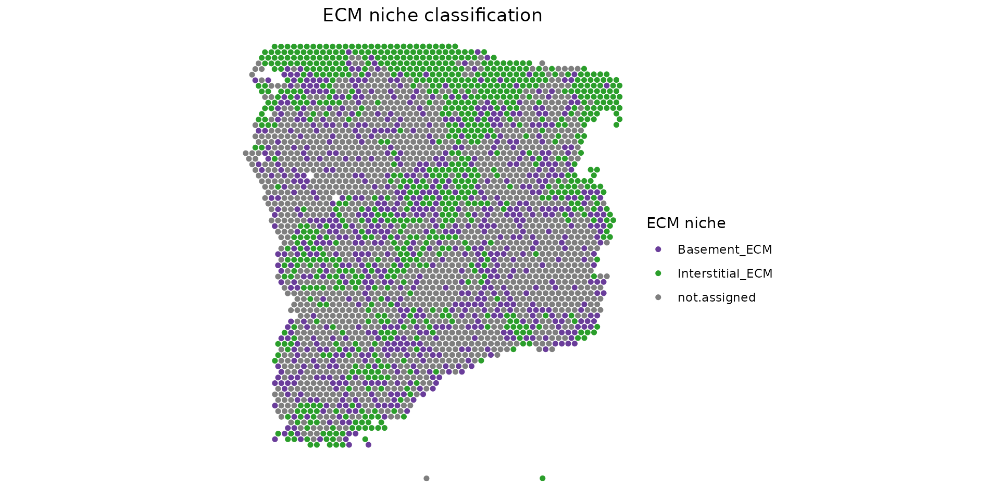
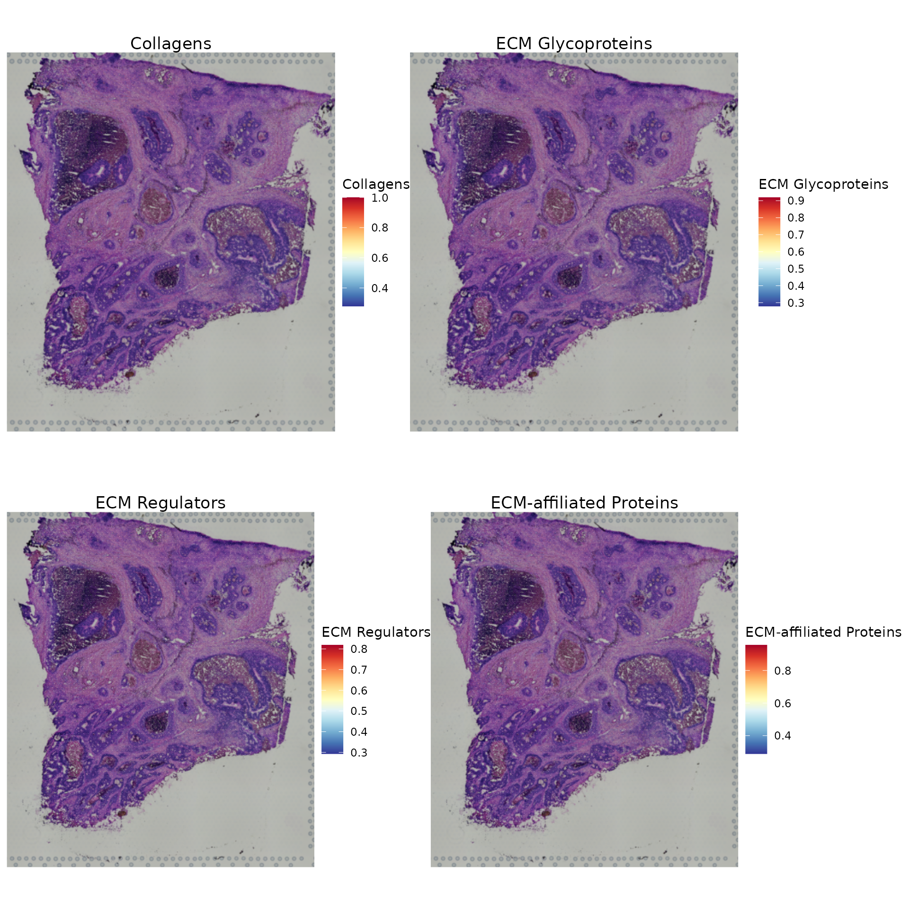
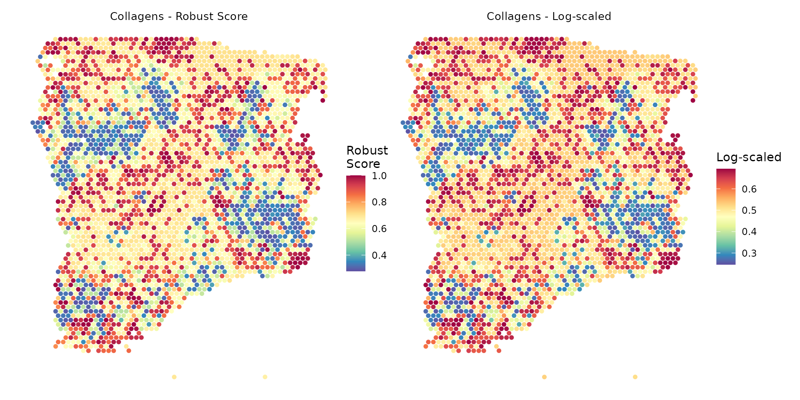
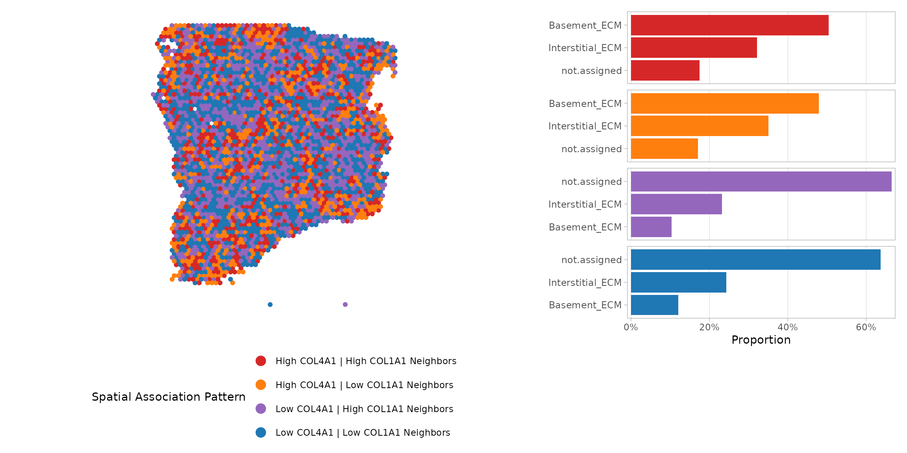
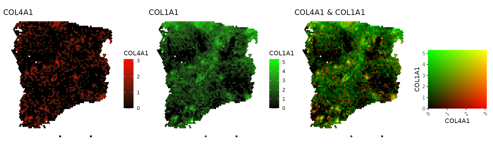
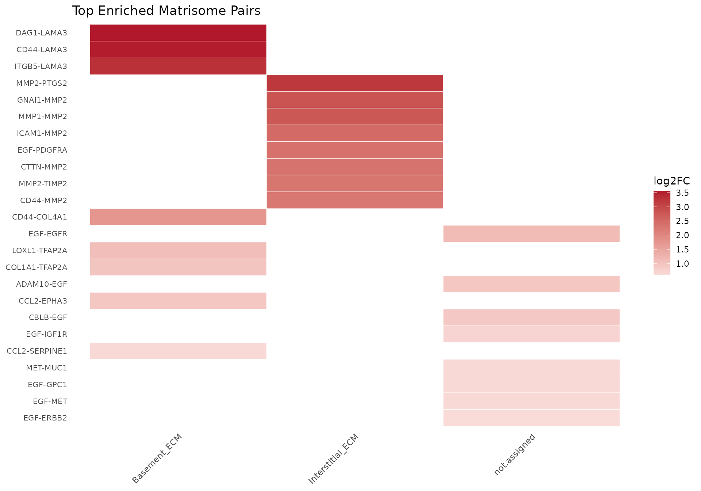
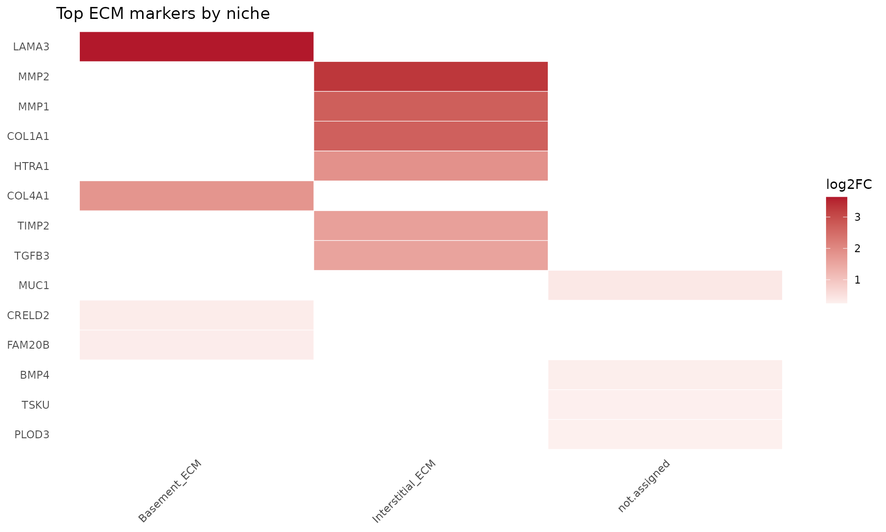

# MatriSpace: Spatially-Resolved ECM Gene Expression Patterns

## Overview

**matrispace** analyzes the extracellular matrix (matrisome) in spatial
transcriptomics data. This demo shows:

- ECM niche classification
- Matrisome expression mapping
- Spatial co-localization (LISA)
- Spatial co-expression analysis of matrisome pairs

**Test dataset:** Spatial transcriptomics sample with matrisome
annotation

------------------------------------------------------------------------

## ECM Niche Annotation

Each spot is classified into an ECM niche (e.g. Interstitial, Basement
membrane) using ScType.

``` r

table(seurat_obj$ecm_niche)
#> 
#>     Basement_ECM Interstitial_ECM     not.assigned 
#>              768              853             1517
```

``` r

ecm_colors <- palette_ecm(unique(seurat_obj$ecm_niche))
coords <- GetTissueCoordinates(seurat_obj)
plot_df <- data.frame(
  imagecol = coords$imagecol,
  imagerow = coords$imagerow,
  niche = seurat_obj$ecm_niche
)

ggplot(plot_df, aes(x = imagecol, y = imagerow, color = niche)) +
  geom_point(size = 1.3) +
  scale_color_manual(values = ecm_colors, name = "ECM niche") +
  scale_y_reverse() +
  coord_fixed() +
  theme_void() +
  labs(title = "ECM niche classification") +
  theme(plot.title = element_text(hjust = 0.5), legend.position = "right")
```



------------------------------------------------------------------------

## Matrisome Expression

UCell scores for matrisome categories visualized spatially.

``` r

p1 <- plot_spatial_feature(seurat_obj, "Collagens", pt.size = 1.3)
p2 <- plot_spatial_feature(seurat_obj, "ECM Glycoproteins", pt.size = 1.3)
p3 <- plot_spatial_feature(seurat_obj, "ECM Regulators", pt.size = 1.3)
p4 <- plot_spatial_feature(seurat_obj, "ECM-affiliated Proteins", pt.size = 1.3)

(p1 | p2) / (p3 | p4)
```



### Dual Normalization View

Robust-normalized and log-scaled scores side-by-side:

``` r

seurat_obj$collagens_robust_score <- seurat_obj@meta.data[["Collagens"]]
seurat_obj$collagens_log_scaled_score <- log1p(seurat_obj@meta.data[["Collagens"]])

plot_matrisome(seurat_obj, "Collagens", "collagens", pt.size = 1.3)
```



------------------------------------------------------------------------

## Spatial Co-localization (LISA)

LISA (Local Indicators of Spatial Association) identifies where two
features cluster together spatially.

``` r

# Analyze COL4A1 vs COL1A1 spatial relationship
lisa_results <- compute_lisa(
  seurat_obj,
  feature1 = "COL4A1", feature1_type = "gene",
  feature2 = "COL1A1", feature2_type = "gene"
)
lisa_results$id <- seurat_obj$ecm_niche

table(lisa_results$LISA)
#> 
#> High.High  High.Low  Low.High   Low.Low 
#>       539       557       987      1055
```

``` r

plot_lisa(
  lisa_results,
  ann_col = "id",
  f1_name = "COL4A1",
  f2_name = "COL1A1"
)
```



**Interpretation:**

| Pattern           | Meaning                                |
|-------------------|----------------------------------------|
| High-High (red)   | COL4A1 high, surrounded by COL1A1 high |
| High-Low (orange) | COL4A1 high, surrounded by COL1A1 low  |
| Low-High (purple) | COL4A1 low, surrounded by COL1A1 high  |
| Low-Low (blue)    | Both low                               |

------------------------------------------------------------------------

## Two-Feature Blend

Visualize co-expression with a 2D color gradient:

``` r

plot_spatial_blend(
  seurat_obj,
  features = c("COL4A1", "COL1A1"),
  feature1_name = "COL4A1",
  feature2_name = "COL1A1"
)
```



------------------------------------------------------------------------

## Matrisome Pair Co-expression Analysis

Matrisome-pair scoring measures spatial co-expression across adjacent
spots for unique heterotypic MatriComDB pairs. It does not infer
signaling direction or communication activity.

``` r

seurat_obj <- score_matrisome_pair_coexpression(seurat_obj, verbose = FALSE)
cat("Matrisome pairs scored:", nrow(seurat_obj[["MATRISOMEPAIR"]]))
#> Matrisome pairs scored: 181
```

### Enrichment by ECM Niche

``` r

pair_stats <- find_matrisome_pair_enrichment(seurat_obj, group_by = "ecm_niche")
```

#### Top Interactions per Niche

``` r

get_top <- function(cluster, n = 5) {
  pair_stats %>%
    filter(cluster == !!cluster) %>%
    slice_max(avg_log2FC, n = n) %>%
    select(feature, avg_log2FC, perc_difference)
}
```

**Interstitial ECM niche:**

``` r

get_top("Interstitial_ECM")
#>               feature avg_log2FC perc_difference
#> MMP2-PTGS2 MMP2-PTGS2   3.222120      0.01203629
#> GNAI1-MMP2 GNAI1-MMP2   2.824030      0.15639229
#> MMP1-MMP2   MMP1-MMP2   2.754735      0.10817016
#> ICAM1-MMP2 ICAM1-MMP2   2.473668      0.39332001
#> EGF-PDGFRA EGF-PDGFRA   2.362420      0.01026984
```

**Basement membrane ECM niche:**

``` r

get_top("Basement_ECM")
#>                   feature avg_log2FC perc_difference
#> DAG1-LAMA3     DAG1-LAMA3   3.558321     0.419587289
#> CD44-LAMA3     CD44-LAMA3   3.523892     0.425253824
#> ITGB5-LAMA3   ITGB5-LAMA3   3.307882     0.405228112
#> CD44-COL4A1   CD44-COL4A1   1.750784     0.466801820
#> LOXL1-TFAP2A LOXL1-TFAP2A   1.077630     0.005775316
```

### Heatmap

``` r

top_pairs <- pair_stats %>%
  group_by(cluster) %>%
  slice_max(avg_log2FC, n = 8) %>%
  ungroup()

ggplot(top_pairs, aes(x = cluster, y = reorder(feature, avg_log2FC), fill = avg_log2FC)) +
  geom_tile(color = "white") +
  scale_fill_gradient2(low = "#2166ac", mid = "white", high = "#b2182b", midpoint = 0) +
  theme_minimal(base_size = 11) +
  theme(
    axis.text.x = element_text(angle = 45, hjust = 1),
    axis.text.y = element_text(size = 8),
    panel.grid = element_blank()
  ) +
  labs(x = NULL, y = NULL, fill = "log2FC",
       title = "Top Enriched Matrisome Pairs")
```



------------------------------------------------------------------------

## Differential ECM Expression

Identify ECM genes differentially expressed between ECM niches.

### Markers for one niche

Compare Interstitial ECM vs all other niches:

``` r

interstitial_markers <- find_ecm_markers(
  seurat_obj,
  ident.1 = "Interstitial_ECM",
  group.by = "ecm_niche",
  verbose = FALSE
)

head(interstitial_markers[, c("gene", "avg_log2FC", "p_val_adj", "subcategory")])
#>          gene avg_log2FC p_val_adj       subcategory
#> MMP2     MMP2  3.3058418         0    ECM Regulators
#> TIMP2   TIMP2  1.6173382         0    ECM Regulators
#> COL1A1 COL1A1  2.6826532         0         Collagens
#> HTRA1   HTRA1  1.8637192         0    ECM Regulators
#> IGFBP3 IGFBP3  1.2185214         0 ECM Glycoproteins
#> CTSD     CTSD  0.7269459         0    ECM Regulators
```

### All niche markers

Find ECM markers for each niche simultaneously:

``` r

all_markers <- find_all_ecm_markers(
  seurat_obj,
  group.by = "ecm_niche",
  verbose = FALSE
)

# Top 3 markers per niche
all_markers %>%
  group_by(cluster) %>%
  slice_max(avg_log2FC, n = 3) %>%
  select(cluster, gene, avg_log2FC, subcategory)
#> # A tibble: 9 × 4
#> # Groups:   cluster [3]
#>   cluster          gene   avg_log2FC subcategory            
#>   <chr>            <chr>       <dbl> <chr>                  
#> 1 Basement_ECM     LAMA3       3.63  ECM Glycoproteins      
#> 2 Basement_ECM     COL4A1      1.81  Collagens              
#> 3 Basement_ECM     CRELD2      0.326 ECM Glycoproteins      
#> 4 Interstitial_ECM MMP2        3.31  ECM Regulators         
#> 5 Interstitial_ECM MMP1        2.71  ECM Regulators         
#> 6 Interstitial_ECM COL1A1      2.68  Collagens              
#> 7 not.assigned     MUC1        0.390 ECM-affiliated Proteins
#> 8 not.assigned     BMP4        0.285 Secreted Factors       
#> 9 not.assigned     TSKU        0.261 ECM Glycoproteins
```

### Category-Specific Analysis

Filter to specific matrisome categories (e.g., collagens only):

``` r

collagen_markers <- find_ecm_markers(
  seurat_obj,
  ident.1 = "Basement_ECM",
  group.by = "ecm_niche",
  categories = "Collagens",
  verbose = FALSE
)
collagen_markers[, c("gene", "avg_log2FC", "p_val_adj")]
#>          gene avg_log2FC    p_val_adj
#> COL4A1 COL4A1  1.8055617 0.000000e+00
#> COL1A1 COL1A1 -0.9341397 3.989846e-05
```

### Visualization

``` r

top_de <- all_markers %>%
  filter(p_val_adj < 0.05) %>%
  group_by(cluster) %>%
  slice_max(avg_log2FC, n = 6) %>%
  ungroup()

ggplot(top_de, aes(x = cluster, y = reorder(gene, avg_log2FC), fill = avg_log2FC)) +
  geom_tile(color = "white") +
  scale_fill_gradient2(low = "#2166ac", mid = "white", high = "#b2182b", midpoint = 0) +
  theme_minimal(base_size = 11) +
  theme(
    axis.text.x = element_text(angle = 45, hjust = 1),
    panel.grid = element_blank()
  ) +
  labs(x = NULL, y = NULL, fill = "log2FC", title = "Top ECM markers by niche")
```



------------------------------------------------------------------------

## Summary

| Function | What it does |
|----|----|
| [`annotate_ecm_niches()`](https://Theayomideo.github.io/matrispace/reference/annotate_ecm_niches.md) | Classify spots into ECM niches |
| [`score_matrisome()`](https://Theayomideo.github.io/matrispace/reference/score_matrisome.md) | Calculate matrisome category scores |
| [`plot_spatial_feature()`](https://Theayomideo.github.io/matrispace/reference/plot_spatial_feature.md) | Map any feature spatially |
| [`compute_lisa()`](https://Theayomideo.github.io/matrispace/reference/compute_lisa.md) | Spatial co-localization statistics |
| [`plot_lisa()`](https://Theayomideo.github.io/matrispace/reference/plot_lisa.md) | Visualize LISA clusters |
| [`plot_spatial_blend()`](https://Theayomideo.github.io/matrispace/reference/plot_spatial_blend.md) | Two-feature overlay |
| [`score_matrisome_pair_coexpression()`](https://Theayomideo.github.io/matrispace/reference/score_matrisome_pair_coexpression.md) | Matrisome-pair spatial co-expression scoring |
| [`find_matrisome_pair_enrichment()`](https://Theayomideo.github.io/matrispace/reference/find_matrisome_pair_enrichment.md) | Matrisome-pair enrichment per group |
| [`find_ecm_markers()`](https://Theayomideo.github.io/matrispace/reference/find_ecm_markers.md) | DE between two groups |
| [`find_all_ecm_markers()`](https://Theayomideo.github.io/matrispace/reference/find_all_ecm_markers.md) | DE for all clusters |

------------------------------------------------------------------------

## Session Info

``` r

si <- sessionInfo()
cat("R version:", si$R.version$version.string, "\n")
#> R version: R version 4.6.2 (2026-10-29)
cat("Platform:", si$platform, "\n\n")
#> Platform: x86_64-pc-linux-gnu
cat("Key packages:\n")
#> Key packages:
pkgs <- c("matrispace", "Seurat", "SeuratObject", "ggplot2", "UCell")
for (pkg in pkgs) {
  if (pkg %in% names(si$otherPkgs)) {
    cat(" ", pkg, ":", as.character(packageVersion(pkg)), "\n")
  }
}
#>   matrispace : 0.1.0 
#>   Seurat : 6.0.0 
#>   SeuratObject : 5.4.0 
#>   ggplot2 : 4.0.4
```
